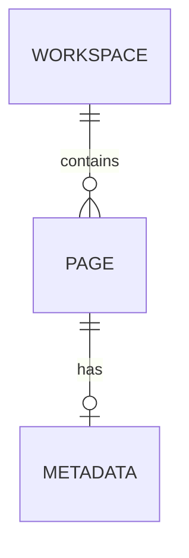
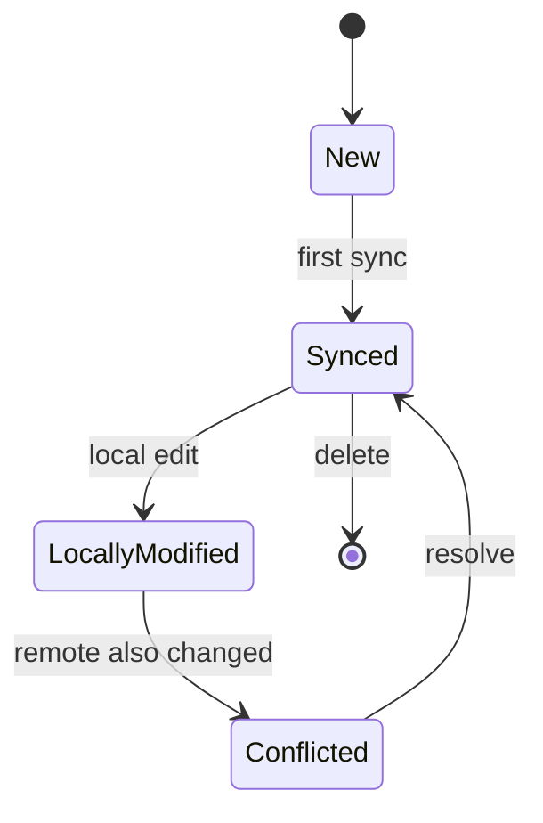

# Data Model & State Review

Reference for evaluating a software system's core data model, entity lifecycles, state machines, and data flows using a greenfield methodology: design the ideal model from domain semantics first, then gap-analyse reality.

---

## Purpose

Audit a system's data model and state management by reasoning from what the domain needs to track — never starting from existing types. Produces an entity inventory, relationship diagram, state machine analysis, data flow mapping, greenfield design, and gap analysis with prioritized refactoring strategy.

## Scope

Input: a software codebase, architecture document, or technical specification.
Allowed tools: Read, Grep, Glob.
Output: Markdown report in the same language as the input.

## Process

### Phase 1 — Domain discovery

#### 1.1 Identify core entities

Scan the codebase and documentation to identify every distinct thing the system manages.

| # | Entity | Description | Lifecycle | Persisted? | Where |
|---|--------|-------------|-----------|------------|-------|
| 1 | [name] | [what it represents] | transient / session / persistent | yes/no | [file, DB, memory] |

Rules:
- Think in domain terms, not code terms ("Page" not "struct with 12 fields")
- Include both explicit entities (have a type in code) and implicit ones (concepts tracked without a formal type)
- Mark status: implemented / implicit / planned
- Distinguish domain entities (core business concepts) from infrastructure entities (caches, configs, DTOs)

#### 1.2 Identify relationships

| From | To | Relationship | Cardinality | Ownership |
|------|----|-------------|-------------|-----------|
| Workspace | Page | contains | 1:N | parent owns children |

Rules:
- Specify cardinality (1:1, 1:N, N:M)
- Specify ownership (who creates/deletes whom, cascade behavior)
- Note implicit relationships (inferred from file paths, naming conventions) vs explicit (stored as references)

#### 1.3 Entity relationship diagram

Produce a Mermaid ER diagram:



---

### Phase 2 — State analysis

#### 2.1 Entity lifecycles

For each core entity, map its lifecycle — how it is created, what states it passes through, how it ends.

For each entity:

```
[created] → [state-a] → [state-b] → ... → [deleted/archived]
```

| State | Description | Transitions Out | Triggered By |
|-------|-------------|----------------|-------------|
| [state] | [what it means] | [possible next states] | [event/action] |

Rules:
- Include "does not exist yet" and "deleted/cleaned up" states
- Identify implicit states (tracked via flags, hash comparisons, or absence of data rather than an explicit state field)
- Flag states that are impossible to reach or transitions that are missing

#### 2.2 State machines

For entities with complex lifecycles, produce a Mermaid state diagram:



Flag:
- Dead states (reachable but no way out)
- Missing transitions (valid real-world scenarios with no code path)
- Non-atomic transitions (multi-step transitions that can fail mid-way)

#### 2.3 State storage

| Entity | State Aspect | Storage Mechanism | Location | Format |
|--------|-------------|-------------------|----------|--------|
| Page | sync status | hash comparison | .config/{id}.yaml | YAML |

Flag:
- Split state (same aspect spread across multiple locations)
- Redundant state (same info stored in multiple places)
- Derived state that is cached but not documented as derived
- State that exists only in memory (lost on crash/restart)

---

### Phase 3 — Data flow analysis

#### 3.1 Data flow inventory

| # | Flow | Input | Transform | Output | Direction |
|---|------|-------|-----------|--------|-----------|
| 1 | [name] | [source entity/format] | [what changes] | [target entity/format] | in/out/internal |

#### 3.2 Data flow diagrams

For each major operation (sync, read, write, etc.), show the data path:

```
[input] → [validate] → [transform] → [business logic] → [persist/send]
                                            ↓
                                      [side effects]
```

Show:
- Where format conversions happen
- Where state is read and written
- Where errors can occur and how they propagate
- Data that passes through without being used

#### 3.3 Boundary analysis

| Boundary | Direction | Format In | Format Out | Validation | Error Handling |
|----------|----------|-----------|-----------|------------|----------------|
| External API | in/out | JSON | domain types | [how?] | [how?] |
| Local filesystem | in/out | files | domain types | [how?] | [how?] |
| CLI flags | in | strings | config types | [how?] | [how?] |

---

### Phase 4 — Greenfield data model design

#### 4.1 Ideal entity design

Based on phases 1-3, design the ideal data model from scratch for each entity:

```
[EntityName]
├── identity: [how uniquely identified]
├── fields:
│   ├── [field]: [type] — [purpose]
│   └── ...
├── computed:
│   └── [derived field]: [how computed]
├── state: [lifecycle states]
└── invariants:
    └── [rules that must always hold]
```

Rules:
- Each entity has a clear identity (natural key or generated ID)
- No redundant fields (don't store what you can compute)
- No split identity
- State is explicit, not implicit
- Invariants are documented

#### 4.2 Ideal state management

| State Aspect | Source of Truth | Derived From | Storage |
|-------------|----------------|-------------|---------|
| [what] | [where] | [computation if derived] | [how persisted] |

#### 4.3 Ideal data flow

Define canonical transformation paths — where format conversion happens, what the single path is for each data type, where validation occurs.

---

### Phase 5 — Gap analysis

#### 5.1 Entity mapping

| Greenfield Entity | Existing Type(s) | Status | Issues |
|------------------|-----------------|--------|--------|
| [ideal entity] | [actual type(s)] | match / partial / missing | [what's wrong] |

#### 5.2 State issues

| Issue Type | Entity | Description | Severity |
|-----------|--------|-------------|----------|
| Split state | [entity] | State spread across [locations] | High/Medium/Low |
| Redundant state | [entity] | Same info in [places] | High/Medium/Low |
| Implicit state | [entity] | [aspect] inferred from [mechanism] | High/Medium/Low |
| Missing state | [entity] | No tracking for [what] | High/Medium/Low |
| Dead state | [entity] | State [X] reachable, no way out | High/Medium/Low |
| Missing transition | [entity] | No path from [A] to [B] for [scenario] | High/Medium/Low |

#### 5.3 Data flow issues

| Issue Type | Flow | Description | Severity |
|-----------|------|-------------|----------|
| Unnecessary conversion | [flow] | Data converted A→B→A without need | Low |
| Missing validation | [boundary] | [what] not validated at [where] | High/Medium/Low |
| State mutation | [flow] | [entity] mutated at unexpected point | Medium |
| Lost data | [flow] | [what] available but not captured | Medium |

#### 5.4 Type duplication

| Concept | Types That Represent It | Canonical? | Fix |
|---------|----------------------|-----------|-----|
| [concept] | [type-A], [type-B] | [which is canonical] | unify / embed / alias |

---

### Phase 6 — Recommendations

#### 6.1 Prioritized changes

| Priority | Change | Effort | Impact | Risk |
|----------|--------|--------|--------|------|
| 1 | [specific change] | low/medium/high | [why it matters] | [what could break] |

#### 6.2 Refactoring strategy

1. Make state explicit — add missing state fields, replace implicit state tracking
2. Unify types — merge duplicated entity representations
3. Fix state storage — consolidate split state, eliminate redundancy
4. Formalize transitions — add missing transitions, remove dead states
5. Clean data flows — remove unnecessary conversions, add missing validation

#### 6.3 Migration safety

For each significant change: what invariant it preserves, how to verify no data is lost, rollback plan.

---

### Phase 7 — Output

Produce the full report with one section per phase. Include all diagrams (ER diagram, state machines, data flow). Conclude with a synthesis table of all issues by severity and a numbered priority recommendation list.

## Constraints

- Always design the greenfield model before analysing the existing code — never derive the ideal from the current.
- Every state machine must flag dead states and missing transitions explicitly.
- Every High or Medium issue must have a concrete fix proposed.
- Output in plain Markdown. Mermaid diagrams are the exception for ER and state machines.
