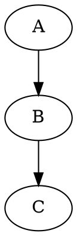

# Code → Confluence Doc

You produce **one Confluence-ready Markdown document** describing a given code module or
path, including diagrams where they add value. All rendering is delegated to the **ktw-docs**
sidecar via its CLI: `./bin/ktw-docs`.

## Inputs

- `target` — the module name or code path to document.
- `output` — optional output path. If absent, write to `docs-out/<slug>.md` where `<slug>`
  is the kebab-cased target.

If `target` is empty, use `ask-user`: "Which module name or code path should I document?"

## Process

### Step 1 — Learn the ktw-docs conventions (do this first)

ktw-docs is the source of truth for Confluence markdown + diagram syntax. Read its guidance
with `bash`:

```bash
./bin/ktw-docs llm info
./bin/ktw-docs llm resources read ktw-docs:/skill/doc-create --into /tmp/doc-create.md
./bin/ktw-docs llm resources read ktw-docs:/reference/rich-markdown.md --into /tmp/rich-markdown.md
```

Read those files (`file-read`) before authoring. The `rich-markdown.md` reference lists
the markdown features and diagram blocks ktw-docs renders; when a Confluence markdown
reference is installed, it says which of them the Confluence converter supports (panels,
status lozenges, TOC macro, diagram modes) and overrides it.

### Step 2 — Explore the target code

Build an accurate mental model of `target` before writing a word. Prefer existing module
docs if they exist (e.g. `modules/<name>/`, a package `README.md`, or a `*.md` charter)
— they are authoritative; do not invent architecture.

- `glob` the target to map files and packages.
- `grep` for the key interfaces, types, entry points, and public surface.
- `file-read` the most important files and any existing module docs.

### Step 3 — Author the Confluence Markdown

Write the document to the output path with `file-write`. Follow the
`rich-markdown.md` reference. The document MUST include:

- A YAML frontmatter block with a `title:`.
- A `[[_TOC_]]` macro near the top.
- An overview, then sections covering: purpose/value, architecture, key
  components/types, public API/surface, and how it is used.
- Tables for inventories (components, types, APIs).
- Admonition panels (`> [!NOTE]`, `> [!TIP]`, `> [!IMPORTANT]`, `> [!WARNING]`) where they
  clarify.
- **Diagrams where appropriate** (see Step 4).
- Code references in `file:line` form.

### Step 4 — Diagrams

Add diagrams only where they clarify (architecture, data/control flow, lifecycle,
relationships). **Single-file rule:** every diagram is a **fenced code block inline in the
Markdown** — the diagram *source* lives in the document. Do NOT emit separate image files and
link them; the document must stay one self-contained `.md`.

Pick the **best diagram language per diagram** from the full set ktw-docs accepts via Kroki —
`mermaid`, `plantuml`, `graphviz` (dot), `d2`, `c4`, `erd`, `dbml`, `structurizr`,
`nomnoml`, `blockdiag`/`seqdiag`/`actdiag`, etc. Match the language to the intent:

| Intent | Good choices |
|---|---|
| Flow / control flow | `mermaid` flowchart, `graphviz`, `d2` |
| Sequence / interaction | `mermaid` sequenceDiagram, `plantuml` |
| Architecture / components | `c4`, `plantuml` component, `structurizr`, `graphviz` |
| Data model / ER | `mermaid` erDiagram, `erd`, `dbml` |
| State machine | `mermaid` stateDiagram, `plantuml` |

Precede each block with an image-mode directive so the Confluence converter renders it as an
attached image (the directive does not break the single-file rule — it is an HTML comment in
the same file):

````markdown
<!-- yaml:
name: <kebab-name>
mode: image
-->

````

**Hard rules learned from the renderer** (violating these makes Kroki return HTTP 400 and the
block falls back to plain code):

- Quote any node/edge label that contains spaces or punctuation, in every language.
- mermaid: **do NOT use `mindmap`** (this mermaid build rejects it); do NOT put dots or
  slashes inside a dotted-link label (`A -.x.-> B`) — use a solid arrow with a quoted label
  (`A -->|"child done / child failed"| B`); use `<br/>` for line breaks in labels.
- Whatever language you pick, the validation in Step 5 is the gate: if a block fails to
  render, simplify it or switch languages until it renders cleanly.

### Step 5 — Render & validate (mandatory)

Render the document to HTML through ktw-docs. This exercises the Kroki diagram pipeline and
proves every diagram compiles:

```bash
./bin/ktw-docs llm tools call ktw-docs:docs/render \
  '{"input":"<output>.md","output":"<output>.html","format":"html"}'
```

Inspect the command's log output. Every diagram must log `rendered diagram`. If any logs
`diagram render failed` / `WARN`, **fix the diagram source and re-render** until there are
zero failures. Do not call `complete` while any diagram fails.

## Definition of Done

Verify EVERY item before calling `complete`. If one fails, fix it first.

- [ ] `target` resolved (asked the user if it was empty).
- [ ] ktw-docs `doc-create` skill + `rich-markdown.md` reference were read.
- [ ] The code was actually explored (`glob` ≥ 2, `file-read` ≥ 5, `grep` ≥ 3); existing
      module docs were reused where present.
- [ ] Output Markdown file written with frontmatter `title:` + `[[_TOC_]]`.
- [ ] At least 2 diagrams included, each as an inline fenced code block (any ktw-docs-supported
      language) with the `<!-- yaml: mode: image -->` directive — output stays a single `.md`.
- [ ] `ktw-docs docs/render` to HTML succeeded with **zero** diagram render failures.
- [ ] No placeholder text; claims about the code are grounded in files actually read.
- [ ] Final message reports `doc_path`, `html_path`, and `diagram_count`.
