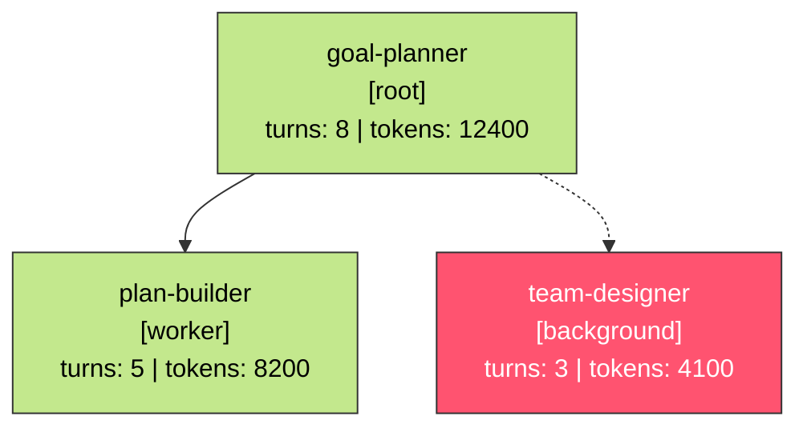

# Mermaid Delegation Graph Rendering

## Graph Type

Use `graph TD` (top-down) for the delegation tree.

## Node Format

Each node represents one agent in the delegation tree:

```
nodeId["task_name<br/>[mode]<br/>turns: N | tokens: M"]
```

- `nodeId`: use the runId (sanitized — replace `-` with `_`)
- `task_name`: the task name from the session tree
- `mode`: delegation mode (worker, background, fork, coordinator, etc.)
- `turns`: number of LLM turns
- `tokens`: total tokens (input + output)

## Edge Styles

| Delegation mode | Arrow style | Meaning |
|----------------|-------------|---------|
| worker | `-->` (solid) | Synchronous — parent waits for child |
| background | `-.->` (dotted) | Asynchronous — parent continues |
| fork | `==>` (thick) | Clone context — independent execution |
| coordinator | `-->` (solid) | Orchestrator → team members |
| team-leader | `-.->` (dotted) | Team member — parallel work |

## Styling



## Rules

1. Root node has mode `[root]`
2. Apply `:::success` for completed agents, `:::error` for failed ones
3. Label edges with mode if it differs from default (`worker`)
4. Keep node labels compact — max 3 lines
5. If the tree has >10 agents, group by depth level with subgraphs
