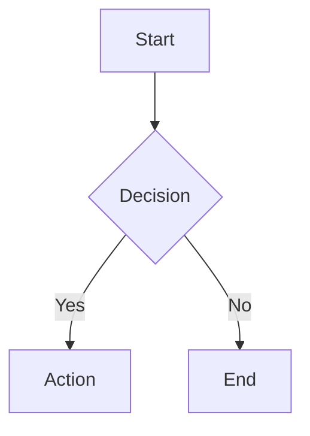
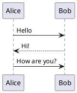
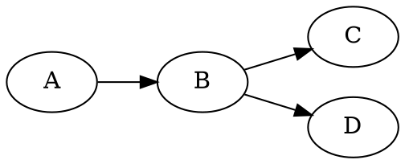
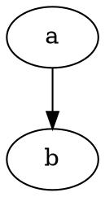

# Markdown Reference for ktw-docs

This document covers every Markdown feature supported by **ktw-docs** when
rendering to HTML, PDF (via Typst), or DOCX (via Pandoc). It serves as both
a reference and a rendering test.

**Output formats:** HTML, PDF, DOCX, PPTX

**Rendering pipeline:** Markdown → preprocessing (alerts, admonitions, emoji, badges, highlights) → diagram rendering (Kroki / draw.io) → Pandoc → output

---

## 1. Frontmatter (YAML Metadata)

Every document can start with a YAML metadata block delimited by `---`:

```yaml
---
title: "Document Title"
author: "Author Name"
date: 2026-03-08
lang: en
abstract: |
  Multi-line abstract that appears at the top
  of the rendered document.
toc: true
toc-depth: 3
numbersections: true
---
```

| Field            | Description                                      | Formats           |
|------------------|--------------------------------------------------|--------------------|
| `title`          | Document title (headers, title page)             | All                |
| `author`         | Author name                                      | All                |
| `date`           | Document date                                    | All                |
| `lang`           | Language code (`en`, `fr`, etc.) for hyphenation  | PDF, HTML          |
| `abstract`       | Abstract text block                              | PDF, HTML          |
| `toc`            | Generate table of contents                       | PDF, HTML          |
| `toc-depth`      | Heading depth for TOC (default: 3)               | PDF, HTML          |
| `numbersections` | Number headings (1.1, 1.2, etc.)                 | PDF, HTML          |
| `keywords`       | Document keywords                                | PDF metadata       |
| `header-includes`| Raw header content (LaTeX/HTML preamble)         | PDF, HTML          |

Additional Pandoc metadata fields are also supported.

---

## 2. Headings

```markdown
# Heading 1
## Heading 2
### Heading 3
#### Heading 4
##### Heading 5
###### Heading 6
```

All six levels are supported. They render as `<h1>` through `<h6>` in HTML and
appear in the PDF table of contents when `toc: true` is set.

### Heading with ID {#custom-id}

Pandoc auto-generates heading IDs for internal linking. You can set a custom ID
with `{#custom-id}` after the heading text.

---

## 3. Text Formatting

| Syntax                   | Renders as            | Notes                |
|--------------------------|-----------------------|----------------------|
| `**bold**`               | **bold**              | All formats          |
| `*italic*`               | *italic*              | All formats          |
| `***bold italic***`      | ***bold italic***     | All formats          |
| `~~strikethrough~~`      | ~~strikethrough~~     | GFM extension        |
| `` `inline code` ``      | `inline code`         | Monospace            |
| `~subscript~`            | H~2~O                 | Pandoc extension     |
| `^superscript^`          | 2^10^                 | Pandoc extension     |
| `[Small caps]{.smallcaps}` | [Small caps]{.smallcaps} | Pandoc extension |

**Live examples:**

- This is **bold text** in a sentence.
- This is *italic text* in a sentence.
- This is ***bold and italic*** combined.
- This is ~~deleted text~~ with strikethrough.
- Use `inline code` for short code references.
- Water is H~2~O and 2^10^ equals 1024.

---

## 4. Paragraphs and Line Breaks

Paragraphs are separated by blank lines. This is the first paragraph.

This is the second paragraph. A single newline within a paragraph is treated
as a space -- the text continues on the same line.

A hard line break uses a backslash at end of line:\
Like this.

Or two trailing spaces at the end of a line
to force a line break.

---

## 5. Lists

### Unordered Lists

- Item one
- Item two
  - Nested item A
  - Nested item B
    - Deeply nested
- Item three

Different markers (`-`, `*`, `+`) are all valid:

* Asterisk item
+ Plus item
- Dash item

### Ordered Lists

1. First item
2. Second item
3. Third item

The starting number is preserved:

3. Starting at three
4. Continues to four
5. And five

### Task Lists (Checkboxes)

- [ ] Incomplete task
- [x] Completed task
- [ ] Another pending task with **bold** text

### Definition Lists

Term 1
:   Definition of term one.

Term 2
:   Definition of term two.
:   A term can have multiple definitions.

### Fancy Lists (Pandoc Extension)

Pandoc supports letter and roman numeral lists:

a. First item
b. Second item
c. Third item

i. Roman one
ii. Roman two
iii. Roman three

### Nested Mixed Lists

1. First ordered item
   - Unordered sub-item
   - Another sub-item
     1. Ordered sub-sub-item
     2. Another ordered
2. Second ordered item

---

## 6. Links

### External Links

[Pandoc documentation](https://pandoc.org)

[Link with title](https://pandoc.org "Pandoc - Universal Document Converter")

### Autolinks

<https://pandoc.org>

### Reference Links

[Pandoc][pandoc-ref]

[pandoc-ref]: https://pandoc.org

### Anchor Links (Internal)

[Jump to Diagrams section](#diagrams)

[Jump to custom ID heading](#custom-id)

### Email Links

<user@example.com>

---

## 7. Images

### External Image (URL)

```markdown

```

External URLs work in **HTML output only**. Typst (PDF) cannot fetch remote
images -- use local files for PDF/DOCX.

### Relative Image (Local File)

```markdown

```

Local images are embedded in DOCX and PDF output automatically.

### Image with Pandoc Attributes

```markdown
{width=80%}
{width=200px height=100px}
{#fig:arch .centered}
```

Supported attributes: `width`, `height`, `#id`, `.class`.

### Diagram File References

Image references to diagram files (`.drawio`, `.mmd`, `.puml`, etc.) are
auto-rendered to images during preprocessing. Example syntax:

    
    

See the [Diagrams section](#diagrams) for details.

---

## 8. Tables

### Pipe Tables (GFM)

| Column A | Column B | Column C |
|----------|----------|----------|
| Cell 1   | Cell 2   | Cell 3   |
| Cell 4   | Cell 5   | Cell 6   |

### Column Alignment

| Left     | Center   | Right    | Default  |
|:---------|:--------:|---------:|----------|
| left     | center   | right    | default  |
| aligned  | aligned  | aligned  | aligned  |

### Table with Inline Formatting

| Feature           | Status     | Notes                    |
|-------------------|------------|--------------------------|
| **Bold**          | `done`     | Works in all outputs     |
| *Italic*          | `done`     | Works in all outputs     |
| ~~Strikethrough~~ | `done`     | GFM extension            |
| `code`            | `done`     | Monospace in cells       |
| [Link](https://example.com) | `done` | Clickable in HTML |

### Multiline Table (Pandoc)

Pandoc multiline tables allow longer cell content:

-------------------------------------------------------------
 Column 1         Column 2           Column 3
-----------       -----------        -----------------------
 Row 1 with       Second column      Third column can span
 multiple lines   content            multiple lines too

 Row 2            More content       Final content
-------------------------------------------------------------

### Grid Table (Pandoc)

+---------------+---------------+--------------------+
| Fruit         | Price         | Advantages         |
+===============+===============+====================+
| Bananas       | $1.34         | - built-in wrapper |
|               |               | - bright color     |
+---------------+---------------+--------------------+
| Oranges       | $2.10         | - cures scurvy     |
|               |               | - tasty            |
+---------------+---------------+--------------------+

### Table with Caption

| Name    | Value |
|---------|-------|
| Alpha   | 1     |
| Beta    | 2     |

: Table 1: Sample data with caption

---

## 9. Code Blocks

### Fenced Code Block

```python
def hello():
    print("Hello, world!")
```

```go
func main() {
    fmt.Println("Hello from Go")
}
```

```bash
echo "Shell script"
ls -la
```

```javascript
const greet = (name) => `Hello, ${name}!`;
console.log(greet("World"));
```

```yaml
server:
  host: 127.0.0.1
  port: 8080
```

```json
{
  "name": "ktw-docs",
  "version": "1.0.0"
}
```

```sql
SELECT u.name, COUNT(o.id) AS orders
FROM users u
LEFT JOIN orders o ON u.id = o.user_id
GROUP BY u.name
HAVING COUNT(o.id) > 5;
```

```html
<div class="container">
  <h1>Title</h1>
  <p>Content goes here.</p>
</div>
```

```css
.container {
  max-width: 800px;
  margin: 0 auto;
  padding: 2rem;
}
```

The language tag controls syntax highlighting in HTML output.

### Indented Code Block

    // Indented by 4 spaces
    var x = 42;

Rendered as a code block with no syntax highlighting.

### Code Block with Pandoc Attributes

```{.python .numberLines startFrom="10"}
def example():
    return True
```

Pandoc supports line numbering (`numberLines`) and custom starting line.

### Inline Code with Language

Use `result`{.python} for language-specific inline code styling.

---

## 10. Diagrams

ktw-docs automatically renders diagram code blocks to images via the
[Kroki](https://kroki.io) API. Diagram code blocks are preprocessed before
Pandoc runs -- no filters or plugins needed.

### How It Works

1. ktw-docs scans for fenced code blocks with a known diagram language tag
2. Each block is sent to Kroki for rendering (SVG or PNG depending on format)
3. The code block is replaced with an image reference
4. Pandoc processes the modified markdown normally

For draw.io files, the local draw.io desktop application is used instead of Kroki.

### Mermaid



### PlantUML



### Graphviz (DOT)



Also available with the `dot` language tag:



### D2

```d2
direction: right
client: Client
server: Server
db: Database

client -> server: Request
server -> db: Query
db -> server: Result
server -> client: Response
```

### ERD (Entity Relationship)

```erd
[Person]
*name
height
weight
+birth_location_id

[Location]
*id
city
state

Person *--1 Location
```

### DBML (Database Markup)

```dbml
Table users {
  id integer [primary key]
  username varchar
  email varchar
  created_at timestamp
}

Table posts {
  id integer [primary key]
  title varchar
  body text
  user_id integer [ref: > users.id]
}
```

### Ditaa (ASCII Art Diagrams)

```ditaa
+--------+   +-------+    +-------+
|        +---+ ditaa |    |       |
|  Text  |   +-------+    | Img   |
|  Doc   |   |       |--->|       |
|     {d}|   | ASCII |    |       |
+---+----+   +-------+    +-------+
    :                         ^
    |       Lots of work      |
    +-------------------------+
```

### BPMN (Business Process)

```bpmn
<?xml version="1.0" encoding="UTF-8"?>
<definitions xmlns="http://www.omg.org/spec/BPMN/20100524/MODEL"
             xmlns:bpmndi="http://www.omg.org/spec/BPMN/20100524/DI"
             xmlns:dc="http://www.omg.org/spec/DD/20100524/DC"
             xmlns:di="http://www.omg.org/spec/DD/20100524/DI"
             id="Definitions_1" targetNamespace="http://bpmn.io/schema/bpmn">
  <process id="Process_1" isExecutable="false">
    <startEvent id="Start" name="Start"/>
    <task id="Task_1" name="Do Work"/>
    <endEvent id="End" name="End"/>
    <sequenceFlow id="Flow_1" sourceRef="Start" targetRef="Task_1"/>
    <sequenceFlow id="Flow_2" sourceRef="Task_1" targetRef="End"/>
  </process>
  <bpmndi:BPMNDiagram id="BPMNDiagram_1">
    <bpmndi:BPMNPlane id="BPMNPlane_1" bpmnElement="Process_1">
      <bpmndi:BPMNShape id="Start_di" bpmnElement="Start">
        <dc:Bounds x="152" y="102" width="36" height="36"/>
      </bpmndi:BPMNShape>
      <bpmndi:BPMNShape id="Task_1_di" bpmnElement="Task_1">
        <dc:Bounds x="240" y="80" width="100" height="80"/>
      </bpmndi:BPMNShape>
      <bpmndi:BPMNShape id="End_di" bpmnElement="End">
        <dc:Bounds x="392" y="102" width="36" height="36"/>
      </bpmndi:BPMNShape>
      <bpmndi:BPMNEdge id="Flow_1_di" bpmnElement="Flow_1">
        <di:waypoint x="188" y="120"/>
        <di:waypoint x="240" y="120"/>
      </bpmndi:BPMNEdge>
      <bpmndi:BPMNEdge id="Flow_2_di" bpmnElement="Flow_2">
        <di:waypoint x="340" y="120"/>
        <di:waypoint x="392" y="120"/>
      </bpmndi:BPMNEdge>
    </bpmndi:BPMNPlane>
  </bpmndi:BPMNDiagram>
</definitions>
```

### C4 PlantUML (Architecture)

```c4plantuml
@startuml
!include https://raw.githubusercontent.com/plantuml-stdlib/C4-PlantUML/master/C4_Container.puml

Person(user, "User", "A user of the system")
System_Boundary(sys, "System") {
    Container(web, "Web App", "React", "Frontend UI")
    Container(api, "API Server", "Go", "REST API")
    ContainerDb(db, "Database", "PostgreSQL", "Stores data")
}

Rel(user, web, "Uses", "HTTPS")
Rel(web, api, "Calls", "JSON/HTTPS")
Rel(api, db, "Reads/Writes", "SQL")
@enduml
```

### All Supported Diagram Types

| Language      | Code fence tag             | File extensions        | Notes                              |
|---------------|----------------------------|------------------------|------------------------------------|
| Mermaid       | `mermaid`                  | `.mmd`, `.mermaid`     | Flowcharts, sequences, Gantt, etc. |
| PlantUML      | `plantuml`                 | `.puml`, `.plantuml`   | UML, C4, Gantt, etc.              |
| Graphviz      | `graphviz`, `dot`          | `.dot`, `.gv`          | Directed/undirected graphs         |
| D2            | `d2`                       | `.d2`                  | Modern diagram language            |
| ERD           | `erd`                      | `.erd`                 | Entity-relationship diagrams       |
| DBML          | `dbml`                     | `.dbml`                | Database markup language           |
| Ditaa         | `ditaa`                    | `.ditaa`               | ASCII art diagrams                 |
| BPMN          | `bpmn`                     | `.bpmn`                | Business process diagrams          |
| C4 PlantUML   | `c4plantuml`, `c4`         |                        | C4 architecture model              |
| BlockDiag     | `blockdiag`                |                        | Block diagrams                     |
| SeqDiag       | `seqdiag`                  |                        | Sequence diagrams                  |
| ActDiag       | `actdiag`                  |                        | Activity diagrams                  |
| NwDiag        | `nwdiag`                   |                        | Network diagrams                   |
| PacketDiag    | `packetdiag`               |                        | Packet header diagrams             |
| RackDiag      | `rackdiag`                 |                        | Rack diagrams                      |
| Nomnoml       | `nomnoml`                  |                        | UML-like hand-drawn style          |
| SvgBob        | `svgbob`                   |                        | ASCII art to SVG                   |
| Excalidraw    | `excalidraw`               |                        | Hand-drawn style diagrams          |
| Pikchr        | `pikchr`                   |                        | PIC-like diagrams                  |
| Structurizr   | `structurizr`              |                        | Architecture DSL                   |
| TikZ          | `tikz`                     | `.tikz`                | LaTeX diagrams                     |
| UMLet         | `umlet`                    |                        | UML diagrams                       |
| Vega          | `vega`                     |                        | Data visualizations                |
| Vega-Lite     | `vegalite`, `vega-lite`    |                        | Simplified Vega                    |
| WaveDrom      | `wavedrom`                 |                        | Digital waveforms                  |
| WireViz       | `wireviz`                  |                        | Wiring harness diagrams            |
| Bytefield     | `bytefield`                |                        | Byte field diagrams                |
| Draw.io       | *(file only)*              | `.drawio`, `.drawio.png`, `.drawio.svg`, `.drawio.xml` | Local rendering via draw.io desktop |

### Image Format Selection

| Output format | Default image format | foreignObject types (mermaid, nomnoml, svgbob) |
|---------------|---------------------|-------------------------------------------------|
| HTML          | SVG                 | SVG (foreignObject works in browsers)           |
| PDF           | SVG                 | PNG (Typst cannot render foreignObject)         |
| DOCX          | SVG                 | PNG (Word cannot render foreignObject)          |

### Draw.io Rendering

Draw.io files are rendered locally via the draw.io desktop application (not Kroki).
Supported file types:

- `.drawio` -- standard XML format
- `.drawio.png` -- PNG with embedded XML (re-rendered when format differs)
- `.drawio.svg` -- SVG with embedded XML (re-rendered when format differs)
- `.drawio.xml` -- XML format

Usage in documents:

```markdown

```

Live example — ktw-docs rendering pipeline architecture:


Or standalone via CLI:

```bash
ktw-docs diagram arch.drawio -o arch.png -f png
ktw-docs diagram arch.drawio -o arch.svg -f svg
```

### CLI Diagram Rendering

Diagrams can be rendered standalone:

```bash
ktw-docs diagram flow.mmd -o flow.svg
ktw-docs diagram plantuml classes.puml -o classes.png -f png
ktw-docs diagram graph.dot              # auto-detects type from extension
ktw-docs diagram arch.drawio -o arch.png -f png
```

---

## 11. Blockquotes

> This is a blockquote.
>
> It can span multiple paragraphs.

> > Nested blockquotes are supported.

> Blockquotes can contain **formatting**, `code`, [links](https://example.com),
> and other inline elements.

> Multi-paragraph blockquote:
>
> First paragraph inside the quote.
>
> Second paragraph with *emphasis*.

---

## 12. Horizontal Rules

Three or more hyphens, asterisks, or underscores:

---

***

___

All produce a horizontal rule (`<hr>` in HTML).

---

## 13. Footnotes

This statement has a footnote[^1]. Another claim uses a named footnote[^note].

[^1]: This is the first footnote. It can contain **formatting** and `code`.

[^note]: Named footnotes work the same way. They can span
    multiple lines with indentation.

    Even multiple paragraphs.

Footnote references appear as superscript numbers. Definitions are collected
at the bottom of the document.

### Inline Footnotes

Pandoc also supports inline footnotes^[Like this one, defined right in the text.]
for quick annotations.

---

## 14. Math (LaTeX)

### Inline Math

Einstein's equation: $E = mc^2$

The quadratic formula: $x = \frac{-b \pm \sqrt{b^2 - 4ac}}{2a}$

Greek letters: $\alpha$, $\beta$, $\gamma$, $\delta$, $\Sigma$, $\Omega$

### Display Math

$$
\int_0^\infty e^{-x^2} dx = \frac{\sqrt{\pi}}{2}
$$

$$
\sum_{n=1}^{\infty} \frac{1}{n^2} = \frac{\pi^2}{6}
$$

$$
\mathbf{A} = \begin{pmatrix} a_{11} & a_{12} \\ a_{21} & a_{22} \end{pmatrix}
$$

Math uses KaTeX in HTML output and native Typst math in PDF.

---

## 15. Fenced Divs (Pandoc Extension)

Custom div containers using Pandoc's fenced div syntax:

::: warning
This is a warning block. It renders as a `<div class="warning">` in HTML.
:::

::: {.note .important}
Multiple classes can be applied to a single div.
:::

::: {.info title="Information"}
Divs can have titles and other attributes.
:::

Fenced divs are the target format for GitHub alerts and MkDocs admonitions
after preprocessing.

---

## 16. Line Blocks

Line blocks preserve line breaks and leading spaces exactly as written:

| The limerick packs laughs anatomical
| In space that is quite economical.
|    But the good ones I've seen
|    So seldom are clean
| And the clean ones so seldom are comical.

---

## 17. HTML Passthrough

### Inline HTML

This has <em>inline HTML</em> and a <br/> line break.

This is <ins>underlined text</ins> via HTML `<ins>` tags.

### Block HTML

<div style="border: 1px solid #ccc; padding: 1em; margin: 1em 0;">
<p>Block-level HTML is passed through to HTML output.</p>
<p>In PDF and DOCX, raw HTML is <strong>ignored</strong>.</p>
</div>

### Collapsible Sections (HTML only)

<details>
<summary>Click to expand</summary>

Hidden content here. Supports markdown inside:

- List items work
- **Bold text** works
- `Code` works

</details>

> **Note:** `<details>` renders in HTML output only. PDF and DOCX ignore it.

---

## 18. GitHub Alerts

GitHub-style blockquote alerts (RFC 9496) are automatically converted to Pandoc
fenced divs during preprocessing:

> [!NOTE]
> This is a note alert. It provides additional context or information.

> [!TIP]
> This is a tip. Use it for helpful suggestions.

> [!IMPORTANT]
> Critical information that users need to know.

> [!WARNING]
> Warning -- potential issues or pitfalls ahead.

> [!CAUTION]
> Negative consequences of an action. Proceed carefully.

### Supported Alert Types

| Alert Type   | CSS Class    | Typical Use                         |
|-------------|--------------|--------------------------------------|
| `[!NOTE]`    | `.note`      | Additional context or information    |
| `[!TIP]`     | `.tip`       | Helpful suggestions                  |
| `[!IMPORTANT]`| `.important`| Critical information                 |
| `[!WARNING]` | `.warning`   | Potential issues or pitfalls         |
| `[!CAUTION]` | `.caution`   | Negative consequences of actions     |

---

## 19. MkDocs Admonitions

MkDocs-style admonitions (`!!!` syntax) are converted to Pandoc fenced divs:

!!! note "A Note"
    This is a note admonition with a custom title.
    It supports **markdown** formatting inside.

!!! warning
    This warning uses the default title (type name capitalized).

!!! tip "Pro Tip"
    Tips are rendered as styled blocks in HTML and indented blocks in PDF/DOCX.

!!! info "Information"
    Any admonition type string is accepted. Common types: `note`, `tip`,
    `warning`, `info`, `danger`, `bug`, `example`, `quote`, `abstract`.

### Collapsible Admonitions

Collapsible admonitions (`???`) are converted to HTML `<details>` blocks:

??? info "Click to expand"
    This content is hidden by default.
    Only visible when the user expands it.

    Supports full markdown inside, including:
    - Lists
    - **Bold** and *italic*
    - `Code blocks`

> **Note:** Collapsible blocks render as expandable sections in HTML output only.
> PDF and DOCX show the content inline.

---

## 20. Status Badges

Status badges create colored lozenges/labels using the syntax
`![TEXT][status-COLOR]`:

### All Badge Colors

| Badge                             | Syntax                            |
|-----------------------------------|-----------------------------------|
| ![TODO][status-grey]              | `![TODO][status-grey]`            |
| ![DRAFT][status-blue]             | `![DRAFT][status-blue]`           |
| ![IN PROGRESS][status-blue]       | `![IN PROGRESS][status-blue]`     |
| ![IN REVIEW][status-purple]       | `![IN REVIEW][status-purple]`     |
| ![BLOCKED][status-red]            | `![BLOCKED][status-red]`          |
| ![PENDING][status-yellow]         | `![PENDING][status-yellow]`       |
| ![DONE][status-green]             | `![DONE][status-green]`           |

### Available Colors

| Color    | Background | Text    | Syntax               |
|----------|------------|---------|----------------------|
| Blue     | `#0052CC`  | white   | `[status-blue]`      |
| Green    | `#00875A`  | white   | `[status-green]`     |
| Yellow   | `#FF991F`  | dark    | `[status-yellow]`    |
| Red      | `#DE350B`  | white   | `[status-red]`       |
| Purple   | `#6554C0`  | white   | `[status-purple]`    |
| Grey     | `#97A0AF`  | dark    | `[status-grey]` or `[status-gray]` |

### Inline Usage

This task is ![IN PROGRESS][status-blue] and needs review. The API is ![DONE][status-green] but docs are ![PENDING][status-yellow].

---

## 21. Highlighted Text

The `==text==` syntax creates highlighted (marked) text:

This is ==highlighted text== in a sentence.

Multiple ==highlights== can appear ==on the same line==.

Use highlights to draw attention to ==key terms== or ==important phrases== in
your documents.

Rendered as `<mark>text</mark>` in HTML.

---

## 22. Emoji Shortcodes

Common emoji shortcodes are converted to Unicode characters. Unknown shortcodes
are left as-is.

### Faces and Gestures

| Shortcode       | Emoji      | Shortcode       | Emoji      |
|-----------------|------------|-----------------|------------|
| `:smile:`       | :smile:    | `:sad:`         | :sad:      |
| `:grin:`        | :grin:     | `:wink:`        | :wink:     |
| `:tongue:`      | :tongue:   | `:thinking:`    | :thinking: |
| `:wave:`        | :wave:     | `:clap:`        | :clap:     |
| `:pray:`        | :pray:     | `:muscle:`      | :muscle:   |
| `:thumbsup:`    | :thumbsup: | `:thumbsdown:`  | :thumbsdown: |
| `:eyes:`        | :eyes:     | `:100:`         | :100:      |

### Symbols and Objects

| Shortcode       | Emoji      | Shortcode       | Emoji      |
|-----------------|------------|-----------------|------------|
| `:star:`        | :star:     | `:heart:`       | :heart:    |
| `:fire:`        | :fire:     | `:rocket:`      | :rocket:   |
| `:tada:`        | :tada:     | `:sparkles:`    | :sparkles: |
| `:zap:`         | :zap:      | `:bulb:`        | :bulb:     |
| `:warning:`     | :warning:  | `:bug:`         | :bug:      |
| `:memo:`        | :memo:     | `:gear:`        | :gear:     |
| `:lock:`        | :lock:     | `:key:`         | :key:      |
| `:link:`        | :link:     | `:package:`     | :package:  |
| `:hammer:`      | :hammer:   | `:wrench:`      | :wrench:   |
| `:books:`       | :books:    | `:pencil:`      | :pencil:   |

### Status and Indicators

| Shortcode              | Emoji               | Shortcode              | Emoji               |
|------------------------|----------------------|------------------------|----------------------|
| `:heavy_check_mark:`   | :heavy_check_mark:   | `:x:`                  | :x:                  |
| `:info:`               | :info:               | `:question:`           | :question:           |
| `:heavy_plus_sign:`    | :heavy_plus_sign:    | `:heavy_minus_sign:`   | :heavy_minus_sign:   |
| `:green_circle:`       | :green_circle:       | `:red_circle:`         | :red_circle:         |
| `:yellow_circle:`      | :yellow_circle:      | `:blue_circle:`        | :blue_circle:        |
| `:white_circle:`       | :white_circle:       | `:black_circle:`       | :black_circle:       |
| `:no_entry:`           | :no_entry:           | `:construction:`       | :construction:       |

### Communication and Data

| Shortcode                     | Emoji                        | Shortcode       | Emoji      |
|-------------------------------|------------------------------|-----------------|------------|
| `:email:`                     | :email:                      | `:bell:`        | :bell:     |
| `:clipboard:`                 | :clipboard:                  | `:calendar:`    | :calendar: |
| `:mag:`                       | :mag:                        | `:hourglass:`   | :hourglass:|
| `:stopwatch:`                 | :stopwatch:                  | `:broken_heart:`| :broken_heart:|
| `:chart_with_upwards_trend:`  | :chart_with_upwards_trend:   |                 |            |

### Arrows

| Shortcode        | Emoji          | Shortcode       | Emoji         |
|------------------|----------------|-----------------|---------------|
| `:arrow_right:`  | :arrow_right:  | `:arrow_left:`  | :arrow_left:  |
| `:arrow_up:`     | :arrow_up:     | `:arrow_down:`  | :arrow_down:  |

### Inline Usage

This feature is :fire: and :rocket: ready! :tada:

Status: :heavy_check_mark: Tests passing :green_circle: Build OK :red_circle: Deploy pending

:warning: Unknown shortcodes like `:unknown_code:` are left as-is.

---

## 23. Special Characters and Escaping

### Backslash Escapes

Use `\` to escape special Markdown characters:

\* Not a list item \
\# Not a heading \
\[ Not a link \
\` Not code \

### Smart Quotes and Dashes (Pandoc)

Pandoc converts straight quotes to "smart quotes" and `--` to en-dash (--),
`---` to em-dash (---) by default.

### Non-Breaking Space

Use `\ ` (backslash space) for a non-breaking space: 100\ km.

### Raw Attribute (Pandoc)

Pass content raw to a specific output format:

```{=html}
<div class="html-only">This only appears in HTML output.</div>
```

```{=latex}
\textbf{This only appears in LaTeX/PDF output.}
```

---

## 24. Spans and Divs with Attributes

### Bracketed Spans

[This text has a custom class]{.highlight} and
[this has an ID]{#special-text .blue}.

### Fenced Divs with Attributes

::: {.callout .blue style="border-left: 3px solid blue; padding-left: 1em;"}
This div has multiple attributes including inline CSS.
:::

---

## 25. Metadata Variables for Templates

Pandoc passes YAML frontmatter variables to templates:

```yaml
---
title: "My Report"
author: "Team"
date: 2026-03-08
abstract: |
  This is a multi-line abstract that appears
  at the top of the document.
toc: true
toc-depth: 3
numbersections: true
---
```

| Variable          | Effect                                      |
|-------------------|---------------------------------------------|
| `toc: true`       | Generate table of contents                  |
| `toc-depth: N`    | Depth of TOC headings                       |
| `numbersections`  | Number headings (1.1, 1.2, etc.)            |
| `abstract`        | Abstract text (PDF/HTML)                    |
| `lang`            | Document language for hyphenation           |

---

## 26. Rendering Cookbook

### Render to HTML

```bash
ktw-docs render document.md -o output.html -t html
```

### Render to PDF (Pandoc + Typst)

```bash
ktw-docs render document.md -o output.pdf -t pdf
```

### Render to DOCX

```bash
ktw-docs render document.md -o output.docx -t docx
```

### Render to PPTX

```bash
ktw-docs render document.md -o output.pptx -t pptx
```

### Render with Custom Template

```bash
ktw-docs render document.md -o output.docx -t docx --reference-doc template.docx
```

### Extra Pandoc Arguments

```bash
ktw-docs render document.md -o output.pdf -t pdf --arg "--toc" --arg "--number-sections"
```

### View Built-In Documentation

```bash
ktw-docs doc                # renders this reference and opens in browser
ktw-docs doc -t pdf -o ref.pdf  # export as PDF instead
```

---

## Appendix A: Feature Compatibility Matrix

| Feature                     | HTML | PDF (Typst) | DOCX | PPTX |
|-----------------------------|:----:|:-----------:|:----:|:----:|
| Headings (H1-H6)           | Yes  | Yes         | Yes  | Yes  |
| Bold / Italic / Strikethrough | Yes | Yes       | Yes  | Yes  |
| Sub/Superscript             | Yes  | Yes         | Yes  | Yes  |
| Inline code                 | Yes  | Yes         | Yes  | Yes  |
| Code blocks (syntax highlight) | Yes | No      | No   | No   |
| Tables (pipe, grid, multiline) | Yes | Yes      | Yes  | Yes  |
| Images (local)              | Yes  | Yes         | Yes  | Yes  |
| Images (remote URL)         | Yes  | No          | No   | No   |
| Diagrams (Kroki)            | Yes  | Yes (PNG)   | Yes (PNG) | Yes (PNG) |
| Diagrams (draw.io)          | Yes  | Yes         | Yes  | Yes  |
| Math (LaTeX)                | Yes  | Yes         | Yes  | No   |
| Footnotes                   | Yes  | Yes         | Yes  | No   |
| Table of contents           | Yes  | Yes         | Yes  | No   |
| GitHub alerts               | Yes  | Yes         | Yes  | Yes  |
| MkDocs admonitions          | Yes  | Yes         | Yes  | Yes  |
| Collapsible sections        | Yes  | No          | No   | No   |
| Status badges               | Yes  | Yes         | Yes  | Yes  |
| Highlighted text            | Yes  | Yes         | Yes  | Yes  |
| Emoji shortcodes            | Yes  | Yes         | Yes  | Yes  |
| Fenced divs                 | Yes  | Yes         | Yes  | Yes  |
| Line blocks                 | Yes  | Yes         | Yes  | No   |
| Definition lists            | Yes  | Yes         | Yes  | No   |
| Task lists (checkboxes)     | Yes  | Yes         | Yes  | No   |
| Smart quotes / dashes       | Yes  | Yes         | Yes  | Yes  |
| Raw HTML passthrough        | Yes  | No          | No   | No   |

## Appendix B: Known Limitations

| Limitation                          | Reason                                           |
|-------------------------------------|--------------------------------------------------|
| Remote images in PDF                | Typst cannot fetch URLs; use local files         |
| D2 PNG output                       | Kroki does not support PNG for D2 diagrams       |
| Draw.io via Kroki                   | Draw.io requires local desktop app, not Kroki    |
| Syntax highlighting in PDF          | Typst does not support Pandoc's highlight styles  |
| `<details>` in PDF/DOCX            | Collapsible sections are HTML-only               |
| PPTX advanced features              | Pandoc PPTX requires slide-level headings        |
