# Flowcharts & Graph Diagrams

Syntax reference for Mermaid, GraphViz (DOT), and D2.

---

## Mermaid

> Quick syntax only. For the full per-type Mermaid references (23 diagram
> types, theming, parser gotchas), load `ktw-docs:/skill/mermaid-syntax`,
> which routes into [mermaid/](mermaid/).

### Flowchart

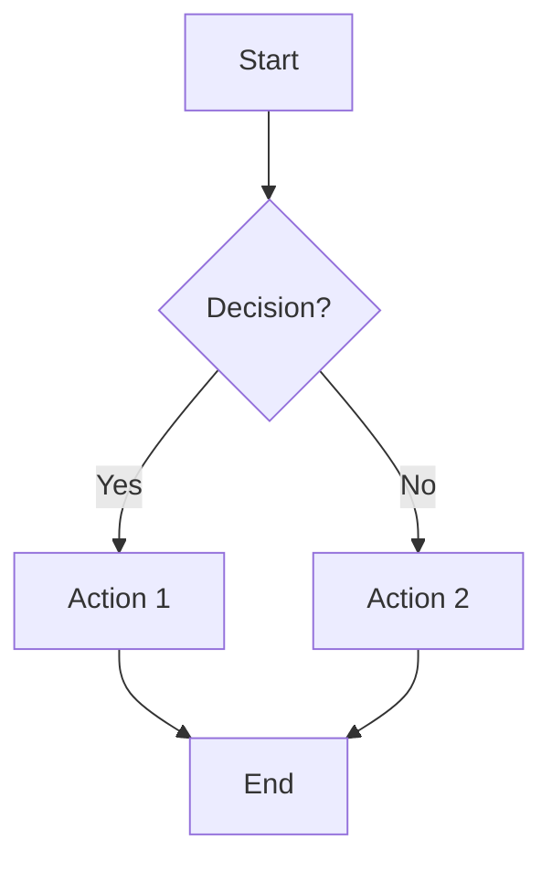

Node shapes: `[rectangle]`, `(rounded)`, `{diamond}`, `([stadium])`, `[[subroutine]]`, `[(cylinder)]`, `((circle))`, `>asymmetric]`, `{hexagon}`, `[/parallelogram/]`, `[\trapezoid\]`

Directions: `TD` (top-down), `LR` (left-right), `BT`, `RL`

Links: `-->` arrow, `---` line, `-.->` dotted, `==>` thick, `--text-->` labeled

Subgraphs:
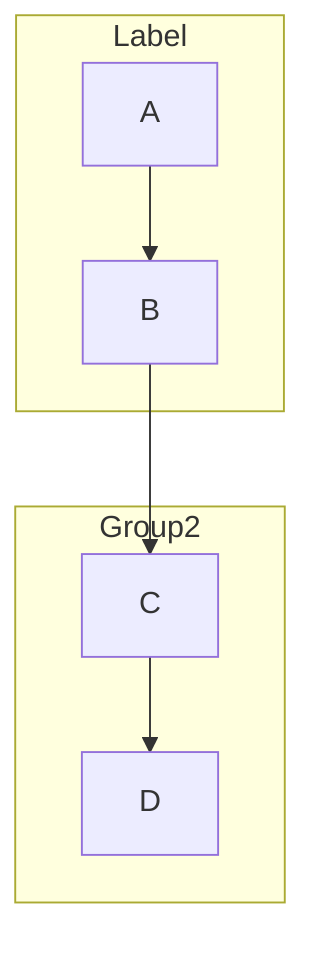

### Sequence Diagram

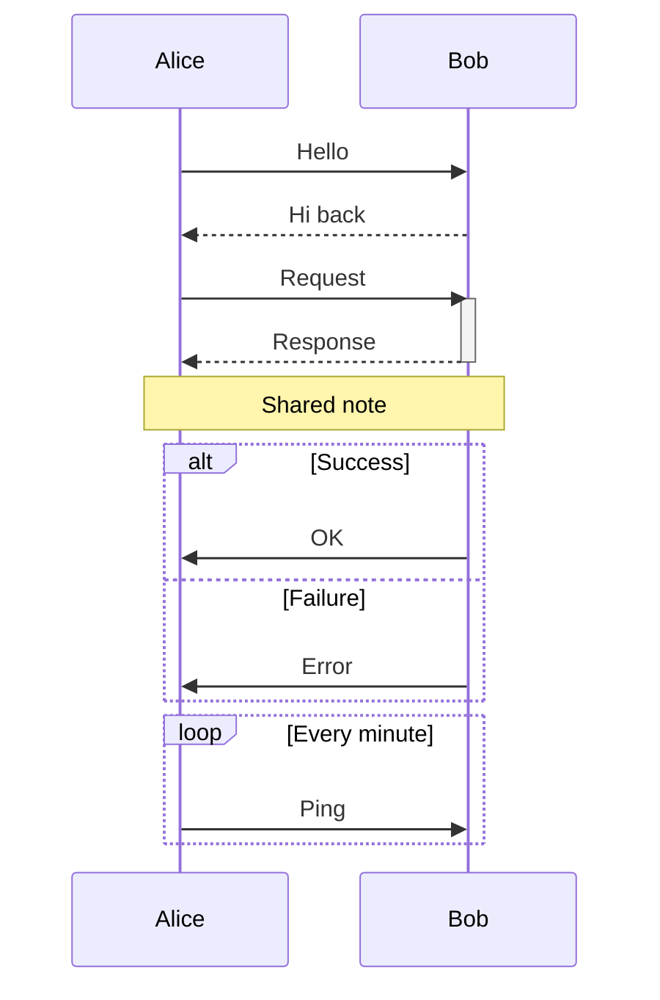

Arrows: `->>` solid, `-->>` dashed, `-x` cross, `-)` open

### Gantt Chart

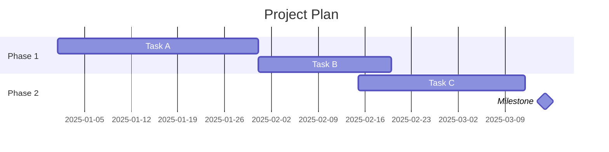

### Pie Chart

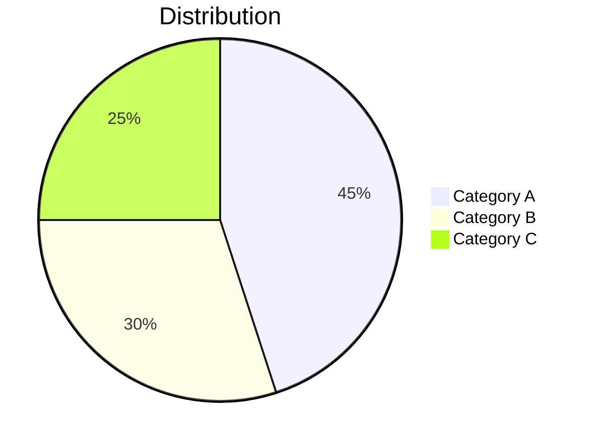

### State Diagram

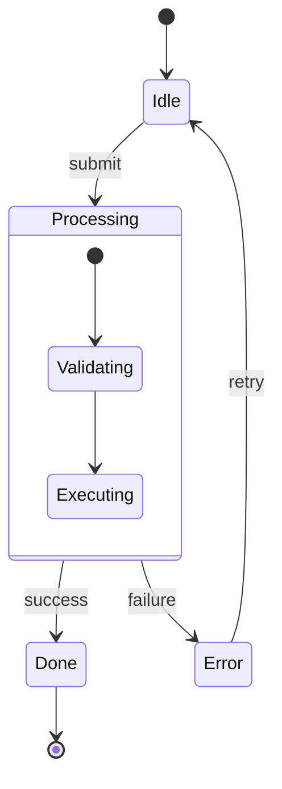

### Git Graph

```mermaid
gitgraph
    commit
    branch develop
    checkout develop
    commit
    commit
    checkout main
    merge develop
    commit
```

### Class Diagram

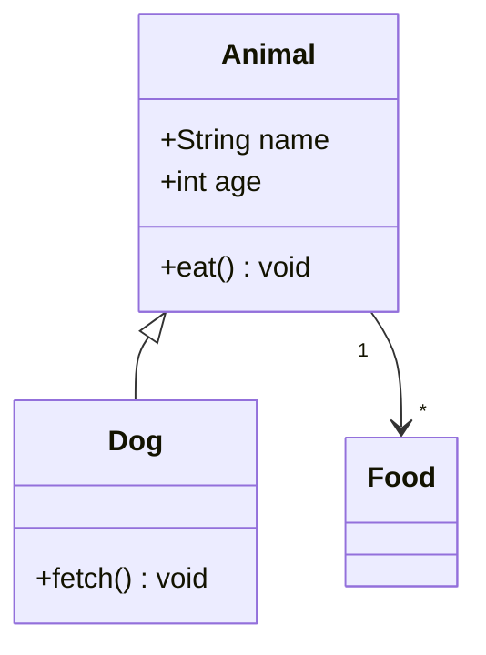

### Entity Relationship

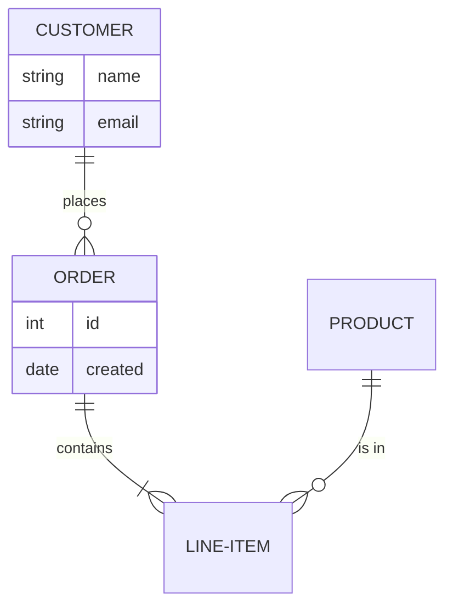

### Mindmap

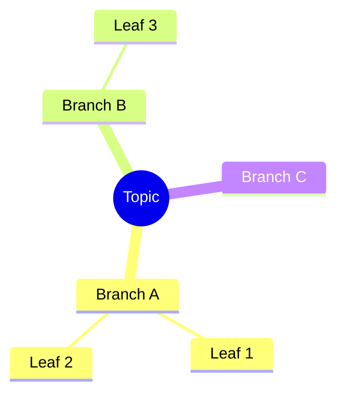

### Timeline

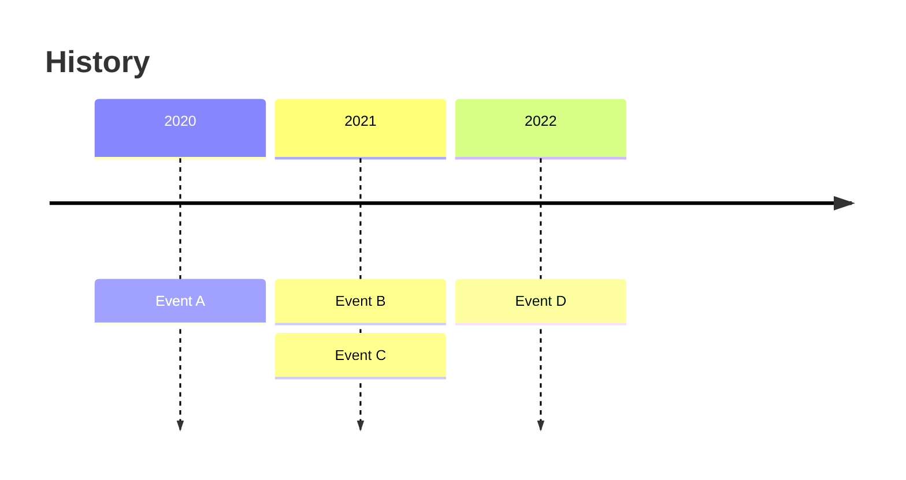

---

## GraphViz (DOT)

### Directed Graph

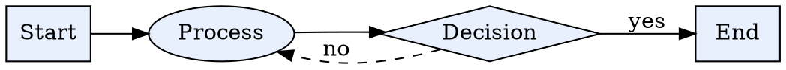

### Undirected Graph

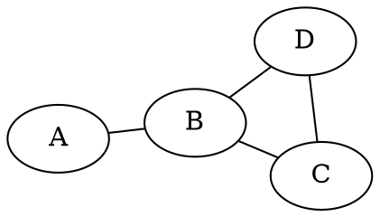

### Cluster Subgraphs

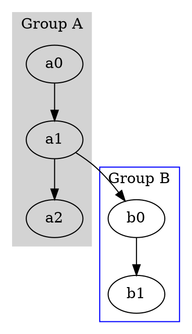

Key shapes: `box`, `ellipse`, `diamond`, `circle`, `record`, `plaintext`, `doublecircle`, `Mrecord`

Layouts: `dot` (hierarchical), `neato` (spring), `fdp` (force-directed), `circo` (circular), `twopi` (radial)

---

## D2

### Basic

```d2
server: Web Server
db: Database {
    shape: cylinder
}
server -> db: queries
server -> client: responses
client: Browser {
    shape: rectangle
}
client -> server: requests
```

### Styled

```d2
direction: right

service: API Service {
    style: {
        fill: "#e8f0fe"
        stroke: "#4285f4"
        border-radius: 8
    }
}

database: PostgreSQL {
    shape: cylinder
    style.fill: "#fce8e6"
}

cache: Redis {
    shape: hexagon
}

service -> database: read/write
service -> cache: get/set
```

### Containers (Nested)

```d2
cloud: AWS {
    vpc: VPC {
        web: Web Tier {
            lb: Load Balancer
            app1: App Server 1
            app2: App Server 2
            lb -> app1
            lb -> app2
        }
        data: Data Tier {
            db: RDS
        }
    }
    web.app1 -> data.db
    web.app2 -> data.db
}
```

### Sequence Diagram

```d2
shape: sequence_diagram
alice -> bob: Hello
bob -> charlie: Forward
charlie -> bob: Reply
bob -> alice: Response
```

Shapes: `rectangle`, `oval`, `cylinder`, `diamond`, `hexagon`, `circle`, `queue`, `package`, `class`, `sequence_diagram`
