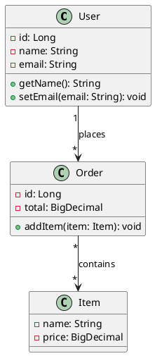
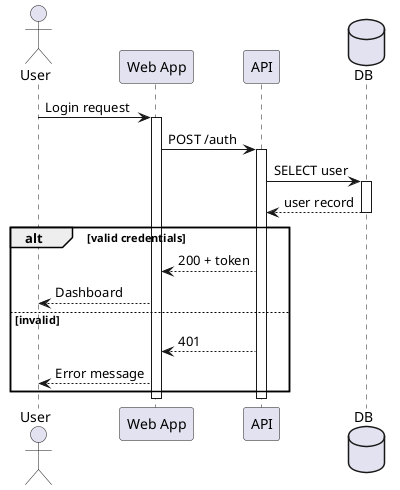
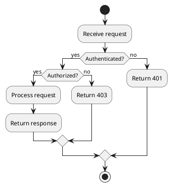
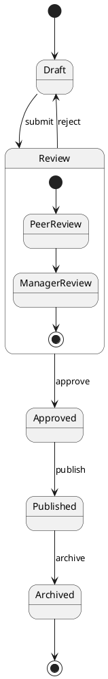
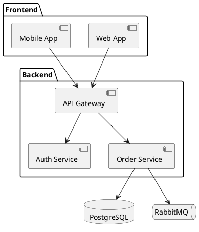
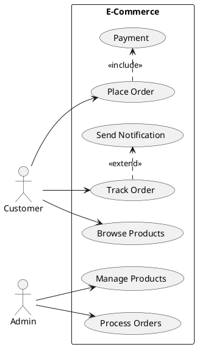
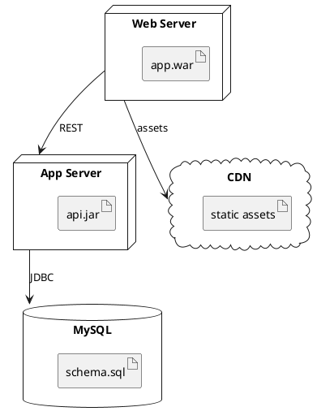
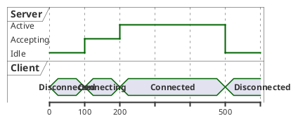

# UML Diagrams

Syntax reference for PlantUML and Nomnoml.

---

## PlantUML

> Quick syntax only. For the full per-type PlantUML references (sequence,
> class, activity, state, ER, component, deployment, use case + styling and
> common errors), load `ktw-docs:/skill/plantuml-syntax`, which routes into
> [plantuml/](plantuml/).

### Class Diagram



Relationships: `--|>` inheritance, `--*` composition, `--o` aggregation, `-->` association, `..>` dependency, `..|>` implementation

Visibility: `-` private, `+` public, `#` protected, `~` package

### Sequence Diagram



### Activity Diagram



### State Diagram



### Component Diagram



### Use Case Diagram



### Deployment Diagram



### Timing Diagram



---

## Nomnoml

Quick, lightweight UML class diagrams.

### Class Diagram

```nomnoml
[User|
    -id: Long;
    -name: String
    |
    +getName(): String;
    +setName(n: String): void
]

[Order|
    -id: Long;
    -items: List
]

[User] 1 -> * [Order]
[Order] *-> * [Product]
```

### Relationships

```nomnoml
[A] -> [B]
[A] --> [B]
[A] -:> [B]
[A] --:> [B]
[A] -o [B]
[A] -+ [B]
[A] o- [B]
```

Arrows: `->` association, `-->` dependency, `-:>` inheritance, `--:>` implementation, `-o` aggregation, `-+` composition, `o-` note

### Styled

```nomnoml
#direction: right
#.important: fill=#f44 visual=rhomb
[<important> Critical Service]
[<abstract> BaseHandler]
[<instance> ConcreteHandler]
[BaseHandler] <:- [ConcreteHandler]
[ConcreteHandler] -> [Critical Service]
```

Classifiers: `<abstract>`, `<instance>`, `<note>`, `<reference>`, `<package>`, `<frame>`, `<database>`, `<start>`, `<end>`, `<state>`, `<choice>`, `<sender>`, `<receiver>`, `<actor>`, `<usecase>`
