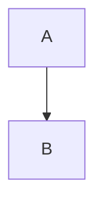

# Rich Markdown Authoring

Reference for creating markdown documents with embedded diagrams, charts, and visual elements rendered via Kroki.

---

## Purpose

Create rich markdown documents with embedded diagrams and visual elements using Kroki-compatible fenced code blocks. Supports 28+ diagram types including Mermaid, PlantUML, GraphViz, D2, Vega-Lite, Excalidraw, BPMN, and more. Use as the authoring step before converting to PDF, DOCX, or slides.

**Publication target matters**: markdown intended for **Confluence** publication must stay inside the Confluence-supported subset (page frontmatter, admonition/panel mapping, collapsible sections, macro and diagram rendering modes). Follow the publishing sidecar's own markdown reference for that target — it overrides this guide wherever the two differ.

## Scope

Input: `$ARGUMENTS` -- a topic, description, outline, or file path.

Output: a `.md` file in the same directory as the input, or in the current working directory.

## Diagram Embedding Pattern

All diagrams use standard fenced code blocks with the diagram type as language identifier:

````

````

These blocks are rendered to images by Kroki (via `https://kroki.io`) during conversion to PDF/DOCX/slides.

## Available Diagram Types -- Quick Reference

| Type | Language ID | Best For | Reference |
|---|---|---|---|
| **Mermaid** | `mermaid` | Flowcharts, sequence, Gantt, pie, git graphs | [flowcharts.md](diagrams/flowcharts.md) |
| **GraphViz** | `graphviz` | Directed/undirected graphs, complex layouts | [flowcharts.md](diagrams/flowcharts.md) |
| **D2** | `d2` | Modern declarative diagrams, styled graphs | [flowcharts.md](diagrams/flowcharts.md) |
| **PlantUML** | `plantuml` | Full UML suite (class, sequence, activity, state, component) | [uml.md](diagrams/uml.md) |
| **Nomnoml** | `nomnoml` | Quick UML class diagrams | [uml.md](diagrams/uml.md) |
| **C4 PlantUML** | `c4plantuml` | C4 architecture model (context, container, component) | [architecture.md](diagrams/architecture.md) |
| **Structurizr** | `structurizr` | C4 model with Structurizr DSL | [architecture.md](diagrams/architecture.md) |
| **Vega** | `vega` | Full data visualization grammar | [data-visualization.md](diagrams/data-visualization.md) |
| **Vega-Lite** | `vegalite` | Concise statistical charts and plots | [data-visualization.md](diagrams/data-visualization.md) |
| **NwDiag** | `nwdiag` | Network topology diagrams | [network-infra.md](diagrams/network-infra.md) |
| **RackDiag** | `rackdiag` | Server rack layouts | [network-infra.md](diagrams/network-infra.md) |
| **PacketDiag** | `packetdiag` | Packet/protocol header diagrams | [network-infra.md](diagrams/network-infra.md) |
| **BlockDiag** | `blockdiag` | Simple block diagrams | [network-infra.md](diagrams/network-infra.md) |
| **SeqDiag** | `seqdiag` | Sequence diagrams (BlockDiag family) | [network-infra.md](diagrams/network-infra.md) |
| **ActDiag** | `actdiag` | Activity diagrams (BlockDiag family) | [network-infra.md](diagrams/network-infra.md) |
| **BPMN** | `bpmn` | Business process diagrams | [misc-diagrams.md](diagrams/misc-diagrams.md) |
| **Excalidraw** | `excalidraw` | Hand-drawn style diagrams (JSON) | [misc-diagrams.md](diagrams/misc-diagrams.md) |
| **Ditaa** | `ditaa` | ASCII art to clean diagrams | [misc-diagrams.md](diagrams/misc-diagrams.md) |
| **SvgBob** | `svgbob` | ASCII art to SVG | [misc-diagrams.md](diagrams/misc-diagrams.md) |
| **Erd** | `erd` | Entity-relationship diagrams | [misc-diagrams.md](diagrams/misc-diagrams.md) |
| **DBML** | `dbml` | Database schema diagrams | [misc-diagrams.md](diagrams/misc-diagrams.md) |
| **WaveDrom** | `wavedrom` | Digital timing/waveform diagrams | [misc-diagrams.md](diagrams/misc-diagrams.md) |
| **Bytefield** | `bytefield` | Byte/protocol field diagrams | [misc-diagrams.md](diagrams/misc-diagrams.md) |
| **WireViz** | `wireviz` | Wiring harness diagrams (YAML) | [misc-diagrams.md](diagrams/misc-diagrams.md) |
| **Pikchr** | `pikchr` | PIC-like technical diagrams | [misc-diagrams.md](diagrams/misc-diagrams.md) |
| **TikZ** | `tikz` | LaTeX TikZ/PGF diagrams | [misc-diagrams.md](diagrams/misc-diagrams.md) |
| **UMLet** | `umlet` | UML diagrams (XML-based) | [misc-diagrams.md](diagrams/misc-diagrams.md) |

Before creating a diagram of a specific type, read the corresponding reference file for syntax details and examples. To pick the right diagram type and engine from an intention, load `ktw-docs:/skill/diagram-create`; for deep Mermaid or PlantUML syntax (per-type references, gotchas), load `ktw-docs:/skill/mermaid-syntax` / `ktw-docs:/skill/plantuml-syntax` instead of working from the family file alone.

Before finalizing any document with diagrams, read [diagram-pitfalls.md](diagrams/diagram-pitfalls.md) for known Kroki/Typst rendering issues (case-sensitive keywords, unsupported directives, required frontmatter fields).

## Process

### Step 1 -- Analyze the request

1. If `$ARGUMENTS` is a file path, read it.
2. Identify the document structure: sections, key points, relationships.
3. Identify which content benefits from visual representation (flows, hierarchies, data, architecture, timelines).
4. Select appropriate diagram types from the table above. Read the relevant diagram reference files for syntax.

### Step 2 -- Compose the document

Write the markdown document combining:

- **YAML frontmatter** with title, author, date, and any metadata needed by downstream conversion.
- **Prose** in standard markdown (headings, lists, emphasis, links, tables, footnotes).
- **Diagrams** as fenced code blocks with appropriate language identifiers.
- **Math** using `$inline$` and `$$display$$` LaTeX syntax where needed.
- **Code blocks** with language identifiers for syntax highlighting.

#### General guidelines

- Place diagrams near the text they illustrate.
- Add a brief caption or description before or after each diagram.
- Prefer Mermaid for quick flowcharts/sequences; PlantUML for detailed UML; D2 for modern styled diagrams; Vega-Lite for data charts.
- Keep diagram source concise -- complex diagrams should still be readable as text.

#### PDF-specific guidelines

When creating markdown destined for PDF (via Pandoc + Typst):

- `mainfont` is REQUIRED in YAML frontmatter -- Typst 0.14+ rejects empty font lists. Safe choices: `"Segoe UI"` (Windows), `"Helvetica Neue"` (macOS), `"DejaVu Sans"` (Linux).
- Include page layout keys: `papersize`, `fontsize`, `margin`, `toc`, `section-numbering`.
- Mermaid/Nomnoml/SvgBob diagrams are auto-converted to PNG (their SVGs use `<foreignObject>` which Typst cannot render).
- Raw Typst blocks can be embedded: ` ```{=typst} ... ``` `
- Read [diagram-pitfalls.md](diagrams/diagram-pitfalls.md) before finalizing.

#### DOCX-specific guidelines

When creating markdown destined for DOCX:

- Headings map directly to Word heading styles (Heading 1, Heading 2, etc.).
- Tables render as Word tables with borders.
- Images are embedded; footnotes become Word footnotes.
- Diagrams are rendered as PNG and embedded by the Kroki filter.

### Step 3 -- Write the output

1. Write to a `.md` file in the same directory as the input, or current working directory.
2. Show the generated content in the response for preview.

### Step 4 -- Suggest next steps

Inform the user they can convert the document using companion doc-create capabilities:

- **PDF** -- compile the markdown to PDF
- **DOCX** -- compile the markdown to DOCX
- **Slides** -- 4-phase presentation pipeline
- **Convert document** -- direct conversion if the markdown is already complete

## Constraints

- All diagram code blocks must use valid language identifiers from the table above.
- Always read the relevant diagram reference file before writing diagram source code.
- Always read [diagram-pitfalls.md](diagrams/diagram-pitfalls.md) before finalizing documents containing diagrams.
- `mainfont` is mandatory in YAML frontmatter for PDF-destined documents.
- Diagrams should be placed near the text they illustrate, with brief captions.
