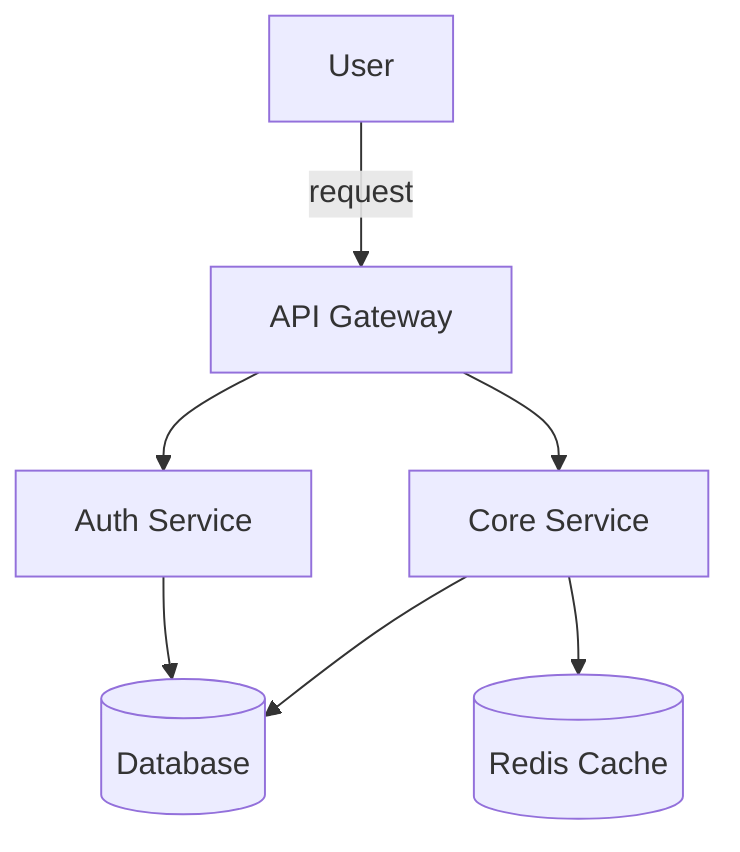
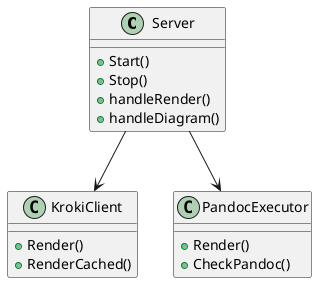
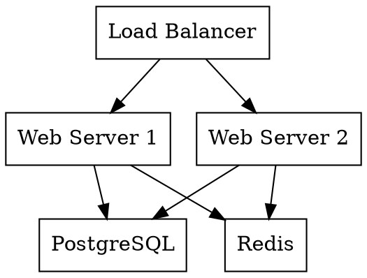
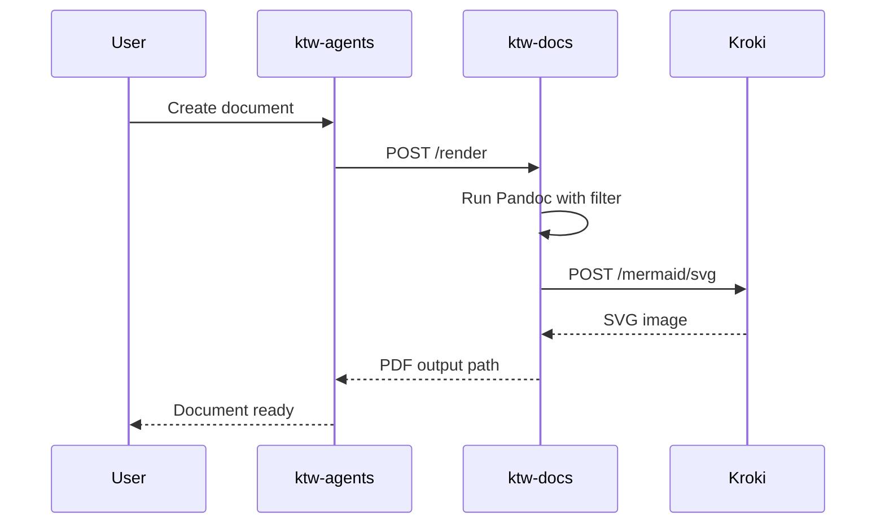

# Architecture Overview

This document tests the Pandoc Kroki filter — diagram code blocks should be replaced with rendered images when using `--filter "ktw-docs filter"`.

## System Flow



## Class Diagram



## Network Topology



## Sequence Diagram



## Entity Relationship

```erd
[Person]
*name
height
weight
+birth_location_id

[Location]
*id
city
state
country

Person *--1 Location
```

## D2 Architecture

```d2
direction: right

client: Client App
server: Backend {
  api: REST API
  worker: Background Worker
  db: PostgreSQL
}

client -> server.api: HTTPS
server.api -> server.db: SQL
server.api -> server.worker: Queue
server.worker -> server.db: SQL
```

## Conclusion

If the Kroki filter is working, all diagram code blocks above should appear as rendered images in the output document.
