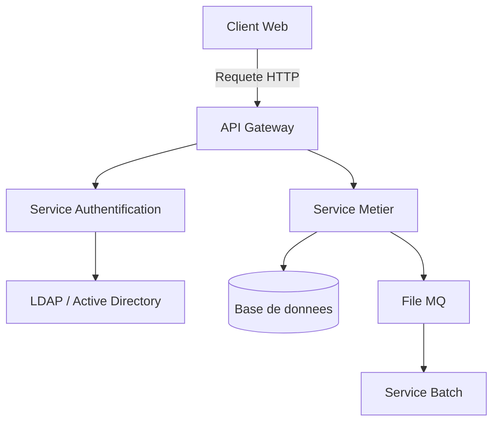
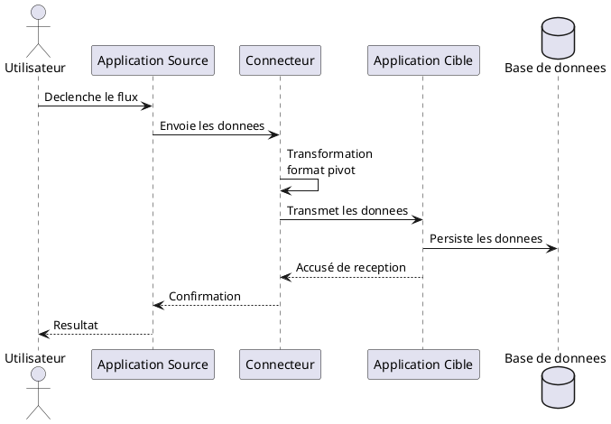
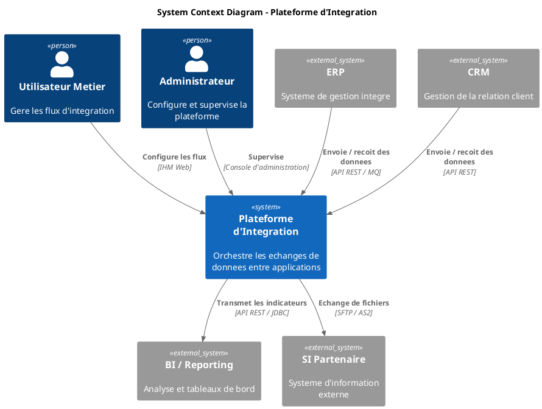
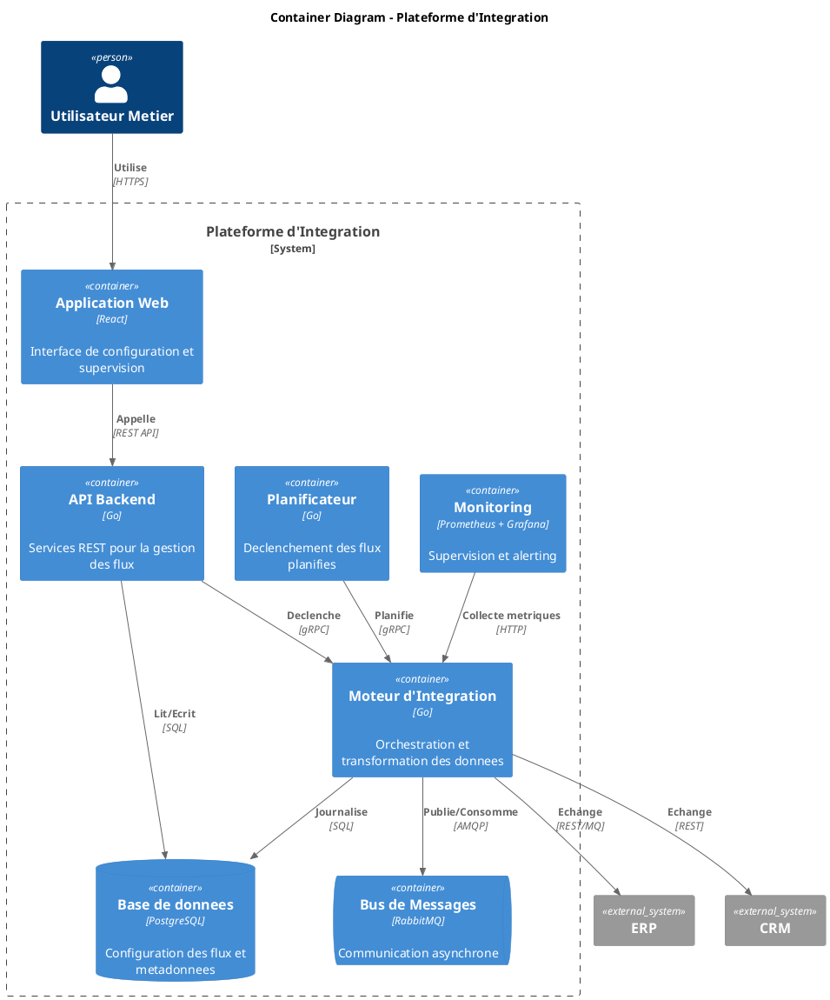
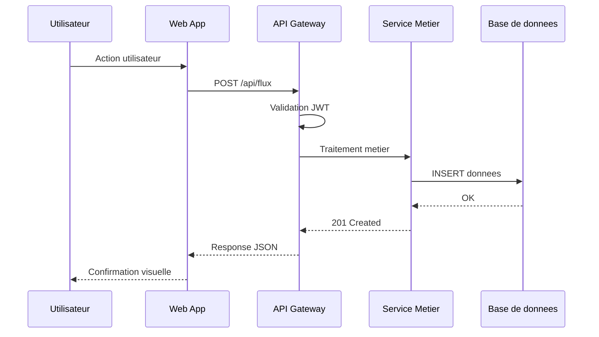

# Test des Diagrammes

Cette page teste les differents types de diagrammes supportes.

## 1. Draw.io (lien image)

Diagramme draw.io integre via un lien image :

## 2. Mermaid

### 2.1 Code block Mermaid

<!-- yaml:
name: diagram_001
-->

### 2.2 Fichier Mermaid (lien)

*(Non applicable - pas de fichier .mmd dans ce workspace)*

## 3. PlantUML

### 3.1 Code block PlantUML

<!-- yaml:
name: diagram_002
-->

## 4. Diagramme C4 (PlantUML C4)

### 4.1 C4 Context Diagram

<!-- yaml:
name: diagram_003
-->

### 4.2 C4 Container Diagram

<!-- yaml:
name: diagram_004
-->

## 5. Diagramme de Sequence Mermaid

<!-- yaml:
name: diagram_005
-->

